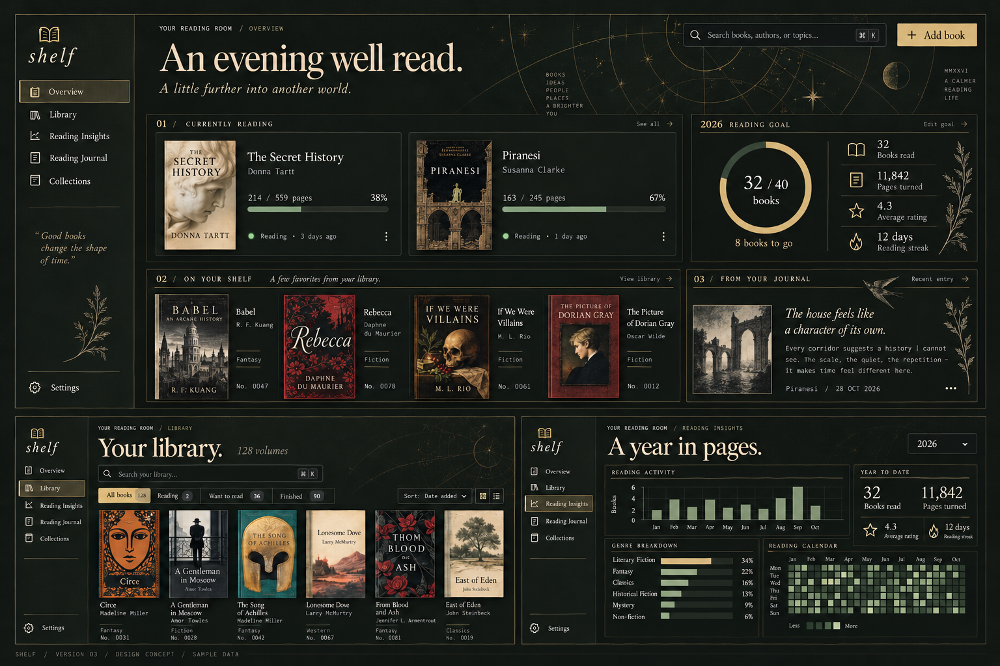

# Shelf visual baseline, version 3

Approved 2026-10-30.

Use version 1's olive charcoal, parchment, aged brass, and moss palette with version 2's journal detail and restrained botanical illustrations. The mockup is a visual reference with illustrative content; the implemented app shows actual catalogue data and empty states.

| Role | Color |
| --- | --- |
| Background | `#171916` |
| Surface | `#21241f` |
| Text | `#e4dcc8` |
| Brass | `#b5a16b` |
| Moss | `#7f9274` |

Use Instrument Serif for headings, IBM Plex Sans for controls, and IBM Plex Mono for compact labels. Keep numbered catalogue sections and thin dividers. Celestial and botanical details stay behind or beside content. Readers and charts must remain usable without decorative imagery.

Book Orbit's browsing, organization, reading, and statistics inform the product roadmap. Its bright turquoise styling is replaced by this approved direction.
