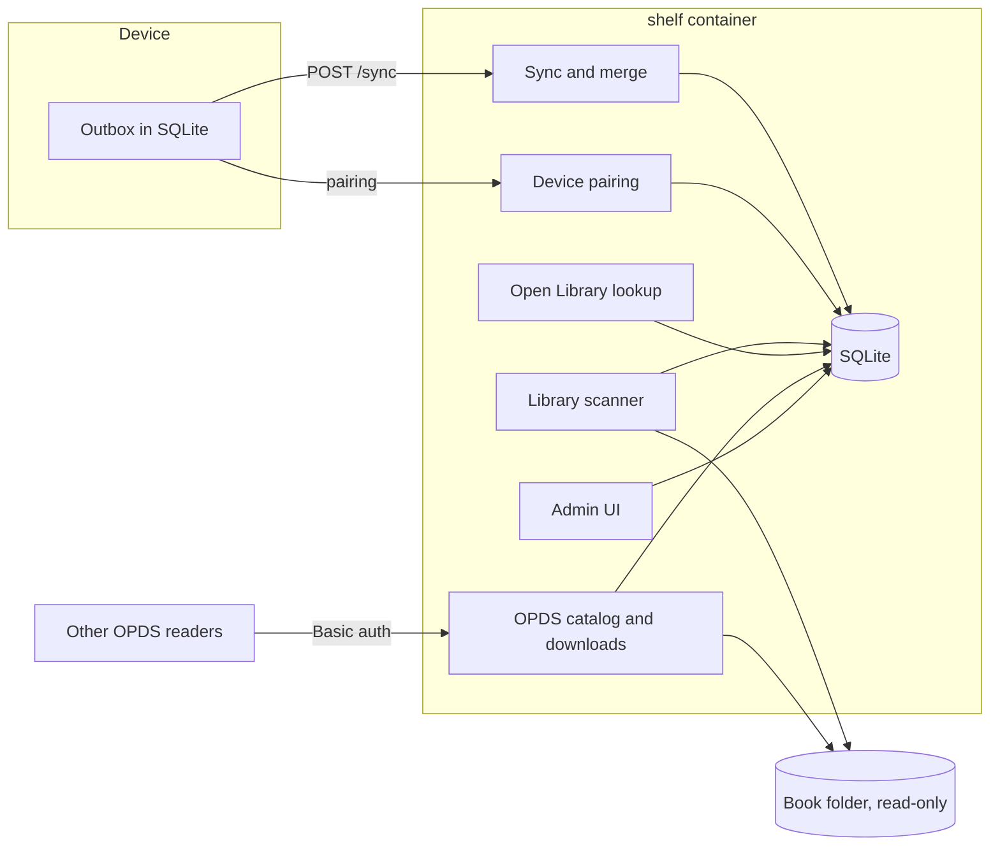

# Shelf architecture

Shelf is the self-hosted book service: catalog, files, and progress sync. This file is the design for [product.md](../product.md) phase 6 (Shelf library) and the server half of phase 7 (Progress sync). Phases 9 and 10 get their own section here when they start.

product.md wins on any conflict. Its locked choices are inputs to this design and are not reopened here: TypeScript on Node 22, one Docker container, SQLite, book files on a local disk, the admin UI served by the same process, local users first, a book identified by a library id plus a content hash, CFI positions, field-level `updated_at` merge, and a device outbox that is authoritative while offline.

product.md says shelf phases can be developed on the host against the protocol. Shelf work therefore runs beside the device phases and does not wait for phases 3 to 5.

Decisions made for this design:

- [0001](../decisions/0001-protocol-json-schema-and-fixtures.md) The protocol is JSON over HTTP, defined by JSON Schema and example fixtures in `protocol/`.
- [0002](../decisions/0002-batch-sync-with-field-records.md) Sync is one batch endpoint that carries typed records with field-level timestamps.
- [0003](../decisions/0003-device-pairing-codes.md) A device signs in with a pairing code, not a password.
- [0004](../decisions/0004-shelf-server-stack.md) The server is Fastify, better-sqlite3, plain SQL migrations, `node:test`, and server-rendered HTML.

## Components

| Component | Job |
| --- | --- |
| Library scanner | Finds EPUB and PDF files in each library folder, hashes them, and keeps the `books` table current. |
| Metadata | Reads title, author, and ISBN from the file, then looks the book up in Open Library. A failed lookup marks the book degraded. |
| OPDS | OPDS 1.2 catalog (Atom XML) and authenticated file download with HTTP range requests. |
| Pairing | Issues a long-lived token to a device after a user approves its code in the admin UI. |
| Sync | Accepts a batch of changed records, merges them field by field, and returns what changed since the device's cursor. |
| Admin UI | First-run setup, login, library and scan status, device approval and revocation, and a book's positions and highlights. |

## Runtime layout

| Path in the container | Contents |
| --- | --- |
| `/books` | The library folder, mounted read-only. Shelf never writes book files. |
| `/data/shelf.db` | SQLite database, WAL mode. |
| `/data/secret` | Session-signing secret, generated on first start. |
| `/data/covers` | Cached cover images. |

`/books` and `/data` stay on a local filesystem. Network mounts are unsupported, as product.md states.

Configuration is environment variables: `SHELF_PORT` (default 8080), `SHELF_DATA` (default `/data`), `SHELF_LIBRARY` (the first library folder, default `/books`), and `SHELF_PUBLIC_URL` (the address devices and OPDS apps use, for absolute links).

## Data model

| Table | Columns | Notes |
| --- | --- | --- |
| `users` | id, name, password_hash, is_admin, created_at | scrypt hash. |
| `sessions` | id, user_id, expires_at | Admin UI login. |
| `devices` | id, user_id, name, token_hash, created_at, last_seen_at, revoked_at | The token itself is shown once to the device and never stored. |
| `pairings` | device_code_hash, user_code, expires_at, approved_device_id | Short-lived. See 0003. |
| `libraries` | id, name, path | The schema allows several libraries. The UI shows one until a second is needed. |
| `books` | id, library_id, sha256, path, size, mtime, format, title, authors, isbn, cover, metadata_status, metadata_checked_at, missing | Unique on (library_id, sha256). `metadata_status` is `ok`, `degraded`, or `pending`. `missing` is set when the file disappears, so its records keep their book. |
| `records` | user_id, id, type, library_id, book_sha256, fields, seq, updated_by_device | Primary key (user_id, id). `fields` is JSON: each field has a value and an `updated_at`. `deleted` is one of those fields. `seq` is the server change counter. See 0002. |
| `meta` | key, value | Next `seq`, schema version. |

A book's identity on the wire is `{ library, hash }`, where `hash` is `sha256:` plus the hex digest of the file. A rename changes `path` and keeps the row.

## Flows

### Scan

1. On start, on a timer, and from the admin UI's scan button, walk each library folder for `.epub` and `.pdf` files.
2. A file whose size and mtime match its row is not hashed again.
3. A new or changed file is hashed only after its size is the same on two passes, so a file still being copied is not imported half-written.
4. A hash already in the library with a new path is a rename: update `path`.
5. A row whose file is gone is marked `missing`, not deleted.
6. New books are queued for metadata.

### Metadata

1. Read title, authors, and ISBN from the file: the OPF package document for EPUB, the document info for PDF.
2. Look up Open Library by ISBN, then by title and author. Fetch the cover.
3. Any failure sets `metadata_status = degraded` and keeps the book listed with whatever the file supplied, or the file name. Degraded books are retried later.
4. Requests are rate-limited and send a User-Agent that identifies shelf, as Open Library asks.

### OPDS and download

- `/opds` is an OPDS 1.2 navigation feed. It links to an acquisition feed of the library, newest first, paged.
- Each entry links to `/books/{id}/file`, which serves the original bytes with the right media type and supports range requests (phase 8 streams audio the same way).
- Files are looked up by book id. A request never names a path, so it cannot reach outside the library.
- OPDS apps use HTTP Basic auth with the user's password. A paired device uses its bearer token for the same URLs.

### Pairing and sync

See [0003](../decisions/0003-device-pairing-codes.md) and [0002](../decisions/0002-batch-sync-with-field-records.md). Message shapes live in [`protocol/`](../../protocol/README.md).

## Failure modes

| Failure | Handling |
| --- | --- |
| Open Library is down or has no match | Book is listed as degraded and retried later. Download still works. |
| File still copying during a scan | Skipped until its size is stable across two passes. |
| Book file renamed or moved within the library | Same hash, same row. Records keep their book. |
| Book file removed | Row marked `missing`. Records stay. The book returns if the file does. |
| Radio drops during sync | The device sends the same batch again. Applying a change twice leaves the same result. |
| Device clock is wrong | The batch carries the device's current time. The server corrects that batch's timestamps by the measured offset. |
| Crash mid-write | Each sync batch and each scan update is one SQLite transaction. |

## Security

- Passwords are hashed with scrypt. Device tokens and pairing device codes are stored as SHA-256 hashes.
- On first start with no users, shelf prints a one-time setup code to the container log. The admin setup page requires it, so another machine on the network cannot claim the server first.
- Login attempts are throttled per account and per address.
- The session secret lives in `/data/secret`, never in git or the image.
- Shelf serves plain HTTP. Use outside the home network goes through a reverse proxy with TLS. The README will say so, because OPDS Basic auth sends the password with every request.
- The book folder is mounted read-only.

## Testing

- Unit tests with `node:test` for the merge rule, cursor paging, clock correction, rename detection, and the stable-size check. The merge rule is the most important code in shelf and gets the most cases.
- Contract tests: every fixture in `protocol/fixtures/` is validated against its schema, and the sync handler is run on the request fixtures and compared to the response fixtures.
- End-to-end: start shelf on a temporary data folder and library, drop in an EPUB, a PDF, and a file with no usable metadata, then read OPDS and download each one. That is the phase 6 "done when".
- CI: a `shelf` workflow runs `npm ci` and `npm test` in `shelf/` on Node 22 when `shelf/` or `protocol/` changes. The existing pytest workflow is unchanged.

## Milestones

One pull request each.

### Phase 6: Shelf library

| # | Pull request | Done when |
| --- | --- | --- |
| 0 | This plan: architecture, ADRs 0001 to 0004, `protocol/README.md` | Reviewed and merged. |
| 1 | Skeleton: `shelf/` package, Fastify, `/health`, SQLite with migrations, Dockerfile, compose file, CI workflow | `docker compose up` serves a healthy shelf. CI runs shelf tests. |
| 2 | Accounts: first-run setup code, admin login, sessions, Basic auth | Setup requires the logged code. Login works. A wrong password is rejected and throttled. |
| 3 | Library scan: walk, hash, stable-size check, renames, missing files | A dropped file gets a row. A renamed file keeps its id. A removed file is marked missing. |
| 4 | Metadata: file metadata, Open Library lookup, covers, degraded status | A known book gets a title and cover. A file with no match is listed as degraded. |
| 5 | OPDS 1.2 feed and authenticated download with range support | Phase 6 "done when": a dropped book appears in OPDS and downloads as the original file, including one whose lookup failed. |
| 6 | Admin UI library page | The library and scan status are visible in a browser. |

### Phase 7: Progress sync, server side

| # | Pull request | Done when |
| --- | --- | --- |
| 7 | `protocol/` schemas and fixtures for pairing, sync, position, bookmark, and highlight | Fixtures validate. The device side has reviewed the shapes. |
| 8 | Device pairing | A test client pairs, gets a token, and syncs. A revoked token is refused. |
| 9 | `POST /sync`: merge, tombstones, cursor, paging, clock correction | Two scripted clients edit the same book offline. Both edits survive. A delete arrives and stays deleted after an older copy syncs. |
| 10 | Admin UI shows a book's positions and highlights | The admin UI can be the second client in the phase 7 "done when". |

Phase 7 is fully done only when the device outbox meets this server. Milestones 7 to 10 prove the server half with scripted clients first.

## Open questions

- **Books shelf does not have.** The device can open a local book that was never in shelf. Do its records sync? If they do, the record needs a book key with no library, for example the hash alone. This shapes the record schema in milestone 7, so the device side should answer it first.
- **The same file twice in one library.** Two paths with one hash are one book. Shelf keeps the first path and lists the other in the admin UI. Confirm that is acceptable.
- **Phase 9 writes Media Overlays into an EPUB.** That changes the file's hash, and the library is read-only. A likely answer is a derived file in `/data`, keyed to the source hash, so the source keeps its identity. Decide when phase 9 starts.
- **OPDS passwords over plain HTTP.** Per-app passwords for OPDS readers would limit the damage of a leaked password. Not needed for phase 6.
